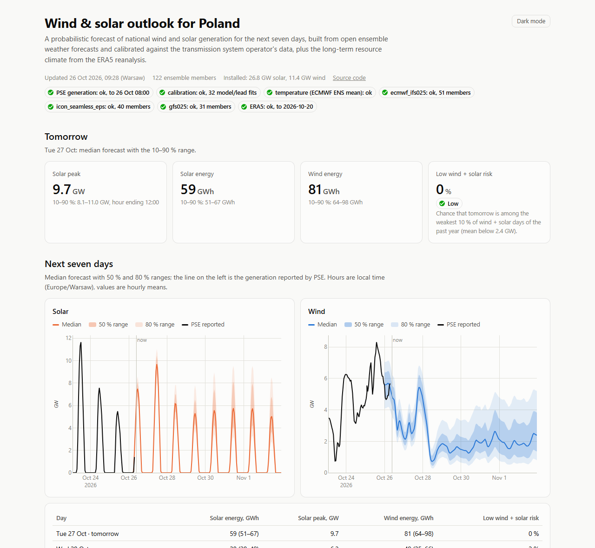
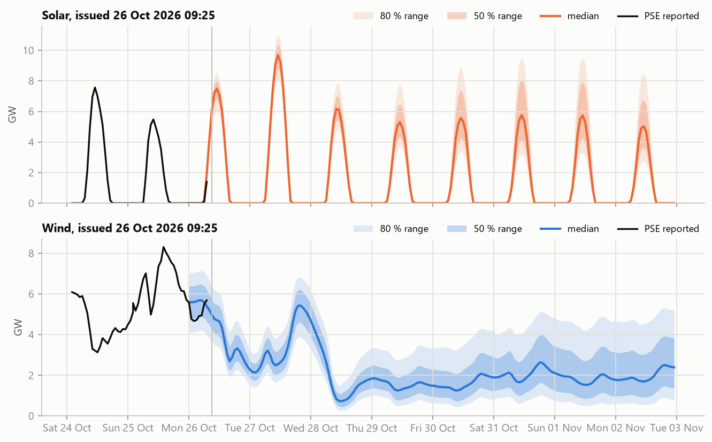
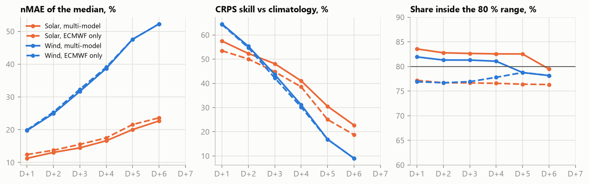
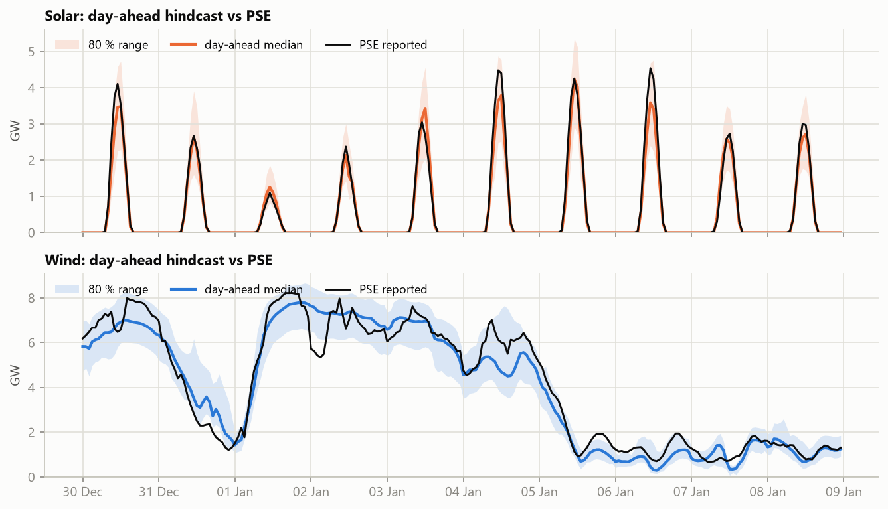
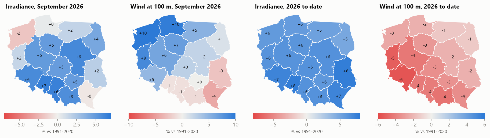
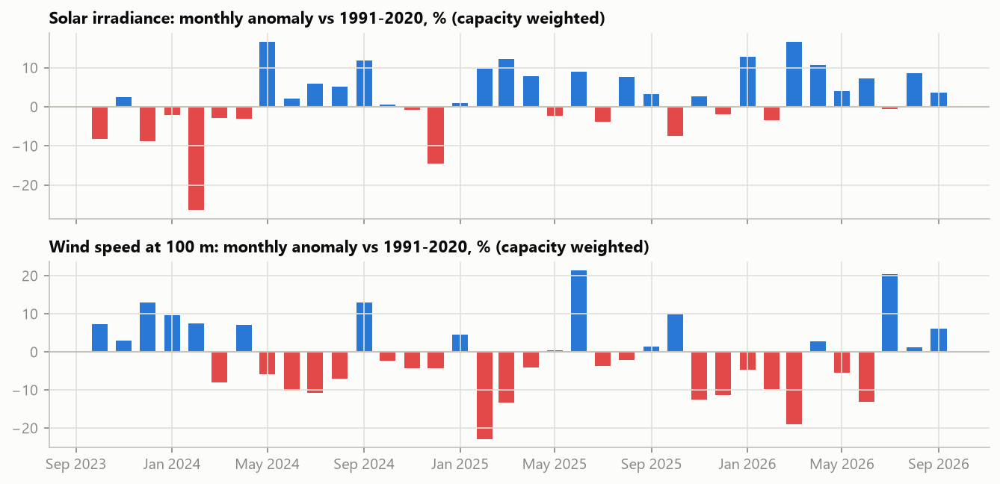
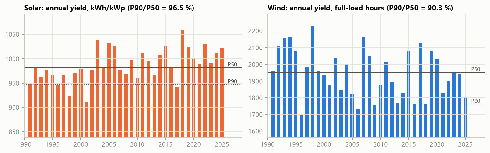

# Wind & solar outlook for Poland


A **probabilistic forecast of national wind and solar generation in Poland for the next seven days**, built only
from open data: ensemble weather forecasts (ECMWF, DWD, NOAA via Open-Meteo) are turned into power with physical
models, calibrated every day against the generation reported by the transmission system operator PSE, and published
as a fan of P10/P50/P90 on a static website that refreshes itself with GitHub Actions. A rolling-origin
**hindcast** shows how good the method is, and an **ERA5 resource climatology** puts the current year in a 35-year
context (anomaly maps, "how was this year for renewables", P50/P90 of annual yield).

**Live site:** https://kwwaleszczynski-del.github.io/pl-res-forecast-climate/ (refreshed every morning)



## Key results

- **Day-ahead accuracy** over a 12-month out-of-sample test (Oct 2025 - Sep 2026), using only model runs published
  by the 08:40 UTC issue time: solar nMAE **11.3 %**, wind nMAE **19.8 %** of mean generation; the probabilistic
  forecast beats a 30-day climatology by **57 %** (solar) and **65 %** (wind) in CRPS, and **84 %** (solar) and
  **82 %** (wind) of observed hours fall inside the published 80 % range. The hindcast uses runs up to 18 h older
  than the live forecast does, so these are conservative.
- **Multi-model beats single-model**: for solar the skill-weighted combination of ECMWF, ICON and GFS is 9 % better
  in CRPS than ECMWF alone; for wind it matches ECMWF and fixes its too-narrow range (77 % -> 82 % coverage).
- **Useful horizon**: wind skill falls to 17 % at D+5 and 9 % at D+6; solar still has 23 % skill at D+6.
- **2026 so far** (to 15 Oct): the sunniest year but one since 1991 (+6.7 % solar yield) and a weak wind year
  (-6.7 %, 26th of 36), with a calm, bright March (-19 % wind speed, +17 % irradiance).
- **Year-to-year risk**: P90/P50 of annual yield is **96.5 %** for solar and **90.3 %** for wind (1991-2025);
  wind varies about twice as much from year to year.



## How it works

```
Open-Meteo ensembles ──► 48 grid points ──► pvlib / fleet power curve ──► national physical MW per member
(ECMWF 51, ICON 40,      (1° lattice,        (capacity-weighted by          │
 GEFS 31 members)         public capacity)    voivodeship)                   ▼
                                                              daily MOS per model and lead, refitted on the
PSE his-wlk-cal (actual wind & PV) ─────────────────────────► last observed days + out-of-sample errors
                                                                             │
                                                                             ▼
                                              dressed multi-model ensemble ─► P05..P95 fan, daily energy, risk
```

1. **Grid and capacity.** A 1° lattice clipped to Poland gives 48 points, each placed at the centroid of the
   Polish part of its cell. Each point represents a share of the public installed capacity of the voivodeships it
   overlaps: URE's register (11.4 GW wind, 12.8 GW licensed PV, June 2026) plus about 14 GW of rooftop PV
   distributed by population. No individual plant locations are used.
2. **Weather to power.** Solar: hourly GHI is split into beam and diffuse (Erbs), transposed onto a mix of
   south-facing and east/west planes (Hay-Davies), corrected for incidence angle and cell temperature (Faiman) and
   converted with a PVWatts-style model with inverter clipping (pvlib). Wind: 80/100 m wind is shifted to a 100 m hub
   height and passed through a generic turbine curve smoothed over the spread of speeds within a cell (a
   multi-turbine power curve).
3. **Calibration (MOS).** For every model and lead day, `y = x·(a + b·min(x, x_max) + c·f) + d` maps the physical
   output `x` onto PSE generation `y`; for solar, `f` are the sun's azimuth and a low-sun indicator, which let the
   fit correct the daily profile (row shading in winter, orientation mix). The fit is redone every day on the
   latest observed window, so the fleet's growth, curtailment and model biases are absorbed without a capacity time
   series.
4. **Uncertainty.** The errors of earlier out-of-sample forecasts, grouped by output level, form an empirical error
   distribution. Every calibrated ensemble member is dressed with the errors of its own model, scaled by
   `k = sqrt(max(k_min², 1 − s²/σ²))` (`s` = ensemble spread, `σ` = typical error): a single deterministic run gets
   the full error distribution, a widely spread ensemble only a fraction of it. Models are weighted by the inverse
   square of their recent out-of-sample error, so a weaker model (ICON's 80 m wind, GEFS radiation) counts less.
5. **Products.** Hourly quantiles P05...P95 for today to D+7, daily energy with ranges, the solar peak, and the
   probability that a day will be among the weakest 10 % of wind + solar days of the past year. Within each day the
   quantiles of the current and the next lead day's calibration are blended linearly, so the fan has no steps at
   midnight.

## Verification

A **rolling-origin hindcast** replays the whole method day by day on archived deterministic runs (Open-Meteo
Previous Runs API) and scores it against PSE generation. Each morning only data available at the 08:40 UTC issue
time are used:

- **Model runs.** For a valid hour the API's `*_previous_dayN` variable is the value predicted N x 24 h earlier,
  i.e. from the run started about N days before that hour (checked against ECMWF IFS single runs). For the D+N
  forecast of a valid hour after 01 UTC this is a 06, 12 or 18 UTC run of the issue day, published after 08:40.
  With a run counted as published 7 h after its start (Open-Meteo states 4-6 h for global models; the rule of
  [pl-forecast-bench](https://github.com/kwwaleszczynski-del/pl-forecast-bench)), the hindcast takes the D+N value
  for 00-01 UTC and the (N+1)-day value, a run of the day before the issue day, for every later hour
  (`hindcast.as_of`, tested in `tests/test_hindcast.py`). This is conservative: for those hours the live forecast
  uses the 00 UTC run of the issue day, 6 to 18 h younger. D+7 would need an eight-day archive and is not scored.
  The archived day-1 temperature has the same timing problem, so the hindcast PV model uses monthly climatological
  air temperature. (The daily calibration of the live forecast fits on past days only, whose runs were all
  published by then.)
- **Observations.** The calibration window ends the day before the issue day and the error distribution comes from
  forecasts that had already been verified. A test checks that changing future observations does not change past
  forecasts.

Window lengths (60 days for solar, 90 for wind), error inflation and `k_min` were chosen on issues before 1 October
2025 (ECMWF from June 2024, ICON and GFS from March 2025); the scores below are for the following **twelve months,
02 Oct 2025 to 30 Sep 2026**, which played no part in the tuning. Solar is scored on daylight hours. nMAE is the
mean absolute error of the median relative to mean generation; the CRPS skill score compares the full distribution
with a 30-day hourly climatology; the 80 % range should contain 80 % of the observations.

| Lead | Solar nMAE | Solar CRPS skill | Solar in 80 % range | Wind nMAE | Wind CRPS skill | Wind in 80 % range |
|---|---|---|---|---|---|---|
| D+1 | 11.3 % | 57 % | 84 % | 19.8 % | 65 % | 82 % |
| D+2 | 13.1 % | 52 % | 83 % | 24.9 % | 55 % | 81 % |
| D+3 | 14.5 % | 48 % | 83 % | 31.7 % | 44 % | 81 % |
| D+4 | 16.6 % | 41 % | 83 % | 38.7 % | 31 % | 81 % |
| D+5 | 20.0 % | 31 % | 83 % | 47.6 % ¹ | 17 % ¹ | 79 % ¹ |
| D+6 | 22.7 % | 23 % | 79 % | 52.3 % ¹ | 9 % ¹ | 78 % ¹ |

¹ Multi-model wind at these leads is ECMWF alone (the scores equal the ECMWF row): GFS has no hub-height wind and
ICON's archived 80 m wind reaches D+4 under the as-of rule. In the live forecast the same holds at D+6 and D+7,
because the ICON-EPS ensemble carries 80 m wind for about five days.



- **Day-ahead**: solar MAE 564 MW on a mean of 5.0 GW, wind 480 MW on
  2.4 GW. Against persistence (the same hour of the last observed day) the median cuts the
  error by 60 % for solar and 71 % for wind.
- **Skill fades with lead time** as weather predictability does: wind is useful to about four or five days (CRPS
  skill 31 % at D+4, 17 % at D+5); solar keeps 23 % skill at D+6 because the daily cycle is known in advance.
- **The ranges are calibrated**: 78-84 % of observations fall inside the published 80 % range at every lead.
  A single model dressed with its own errors is too narrow (75-79 %); the spread between models carries real
  information about uncertainty.
- **Seasons**: solar day-ahead nMAE is 10-12 % from March to October and 16-22 % from November to February (snow on
  modules, fog and low sun). Wind errors are of the same order in MW all year (300-650 MW a month), so they are larger
  in relative terms in the calmer months from April to September (20-27 % against 14-16 % from October to
  January).

| Day-ahead (D+1) | Solar CRPS, MW | Solar in 80 % range | Wind CRPS, MW | Wind in 80 % range |
|---|---|---|---|---|
| **Multi-model (published)** | 405 | 84 % | 346 | 82 % |
| ECMWF IFS only | 443 | 77 % | 348 | 77 % |
| DWD ICON only | 436 | 76 % | 419 | 77 % |
| NOAA GFS only | 521 | 76 % | n/a | n/a |

The multi-model combination beats every single model for solar and matches the best single model (ECMWF) for wind
while widening its too-narrow range. ICON's 80 m wind is the weakest wind input (D+1 CRPS 419 against 348 MW for
ECMWF), which is why the models are weighted by their recent error rather than equally.



*Ten days around New Year 2026, the stretch of the test period with the largest swings in wind output: day-ahead
median and 80 % range against PSE generation.*

**Live verification.** The hindcast cannot use the live ensembles (Open-Meteo keeps individual ensemble members for
only a few days), so every published forecast is archived on the `forecast-archive` branch and the website scores the
archived day-ahead forecasts against PSE once a week of them has accumulated.

## Resource climate

Daily ERA5 irradiance and 100 m wind on the same 48 points, 1 January 1991 to 15 October 2026. Monthly anomalies
are relative to the 1991-2020 normal of each calendar month; national values weight the points by installed capacity
(PV capacity for irradiance, wind capacity for wind), so they describe the resource where the fleet actually is.



**How has 2026 been for renewables?** From 1 January to 15 October the solar yield of today's fleet layout was
**6.7 % above** the 1991-2020 mean of the same period, the **2nd best** of 36 years; the wind yield was **6.7 % below**,
26th of 36. March 2026 shows the two extremes in one month: irradiance +17 % and wind speed -19 %. A windy July
(+20 %) and September (+6 %) only partly made up for a calm spring.



**P50 / P90 of annual yield.** Daily ERA5 values are converted to energy with transfer functions derived from one
year of hourly ERA5 run through the same power models (see `climate.py`), for today's fleet layout and generic
equipment, 1991-2025:

| | Mean | Year-to-year variability | P50 | P90 (exceeded in 9 of 10 years) | P90 / P50 |
|---|---|---|---|---|---|
| Solar, kWh/kWp | 987 | 3.4 % | 982 | 948 | 96.5 % |
| Wind, full-load hours | 1 950 | 7.3 % | 1 952 | 1 763 | 90.3 % |

Wind is about twice as variable from year to year as solar, which is why a one-year P90 haircut matters far more
for wind project finance. The best and worst years span 1 699-2 233 full-load hours for wind (1996 vs 1998) and
912-1 059 kWh/kWp for solar (2001 vs 2018). The solar resource has brightened (2011-2025 is 3.4 % above 1991-2005)
while the wind resource has weakened by 3.6 % over the same comparison. The absolute levels are generic; the
variability is the robust part.



## Running it

```bash
python -m venv .venv
.venv/Scripts/python -m pip install -e ".[dev]"    # Linux/macOS: .venv/bin/python
python -m res_forecast backfill        # one-off history download; resumable, paced to Open-Meteo's free limits
python -m res_forecast hindcast --tune # tune on the first year of the hindcast, verify on the rest
python -m res_forecast climate         # ERA5 climatology, writes the base tables to results/climate
python -m res_forecast update          # daily run: live forecast, archive, site/index.html
python -m res_forecast update --offline   # re-render from cached data only, no API requests
pytest -q                              # offline tests
```

The backfill needs about two days of the free Open-Meteo budget (roughly 20 000 weighted calls, mostly 35 years of
daily ERA5 on 48 points); a daily update costs about 1 100 calls. Downloads are cached as Parquet in `data/`
(git-ignored). `results/` holds the small committed outputs: hindcast scores and parameters, and the ERA5 base
tables that let the daily run fetch only the current year.

**Automation.** `.github/workflows/daily.yml` runs `update` and deploys `site/` to GitHub Pages. Issued forecasts
are appended to a separate `forecast-archive` branch, so the main branch does not grow; the archive feeds the live
verification on the page. It runs every day at 08:40 UTC, after the 00 UTC ensemble runs are available.

## Data and licences

| Data | Source | Licence / terms |
|---|---|---|
| Ensemble forecasts, archived runs, ERA5 | [Open-Meteo](https://open-meteo.com/) APIs (free, non-commercial tier) | CC BY 4.0 |
| ECMWF IFS / IFS ENS | European Centre for Medium-Range Weather Forecasts, via Open-Meteo | CC BY 4.0 |
| ICON / ICON-EPS | Deutscher Wetterdienst, via Open-Meteo | DWD open data, attribution |
| GFS / GEFS | NOAA NCEP, via Open-Meteo | US government public domain |
| ERA5 reanalysis | Copernicus Climate Change Service (C3S), via Open-Meteo | Contains modified Copernicus Climate Change Service information; neither the European Commission nor ECMWF is responsible for any use |
| Wind and solar generation | [PSE S.A.](https://raporty.pse.pl/) reports API (`his-wlk-cal`), read with [pse-opendata](https://pypi.org/project/pse-opendata/) | public reports, attribution |
| Installed capacity | [URE](https://www.ure.gov.pl/) "Mapa OZE", 30 Jun 2026 (voivodeship sums only) | public information |
| Population | GUS, 31 Dec 2025 | public statistics |
| Voivodeship borders | [Natural Earth](https://www.naturalearthdata.com/) 1:10m admin-1 | public domain |

This project is independent and not affiliated with or endorsed by any of these organisations.

## Limitations

- National totals only. The 1° grid and voivodeship-level capacity are too coarse for regional or plant-level use.
- Curtailment, negative-price shutdowns and grid constraints are only captured statistically by the rolling
  calibration; days with unusual curtailment are under-predicted by the error model.
- PSE's solar figure includes an estimate of rooftop generation and is revised; it is treated as the truth here.
- Archived ensemble members are not available, so the hindcast verifies a three-member multi-model ensemble of the
  deterministic runs, not the live 122-member ensemble. The live forecast is verified separately as its archive
  grows.
- The Previous Runs archive does not keep whole runs, so the as-of hindcast takes most hours from a run of the day
  before the issue day and understates the skill of a forecast from the 00 UTC run; D+7 is not scored. The Open-Meteo
  Single Runs API keeps whole runs, but rebuilding the hindcast on it would need about 100 000 weighted calls (ten
  days of the free tier).
- The hindcast starts in mid-2024 (PSE data), ICON and GFS runs from March 2025, so rare extremes are
  under-sampled.
- The annual yields use generic equipment and today's fleet layout; they describe the resource, not the output of a
  particular plant.

## Project layout

```
src/res_forecast/
  openmeteo.py    API client with weighted rate limiting      pse.py         PSE generation
  geo.py          grid, voivodeships, capacity weights        history.py     cached archived runs and ERA5
  power.py        pvlib PV fleet, multi-turbine wind curve    physical.py    national physical output
  calibration.py  MOS, error model, dressing, CRPS            hindcast.py    rolling-origin hindcast
  forecast.py     live ensemble forecast and KPIs             verify.py      scores
  climate.py      ERA5 anomalies and annual yields            archive.py     archive and live verification
  site.py         static website (templates/index.html)       plots.py       README charts
tools/build_static_data.py   builds the capacity table and borders from URE and Natural Earth
```

## Changes

- 2026-10-31: the hindcast used the archived `previous_dayN` values as they are, which for most hours come from
  runs started after the 08:40 UTC issue time; that inflated the day-ahead CRPS skill (solar 60 % instead of 57 %,
  wind 68 % instead of 65 %) and the reported skill at every lead. It now applies the as-of rule above, scores
  D+1 to D+6, uses climatological temperature for PV and was re-tuned (wind window 90 instead of 120 days).

## License

MIT, see [LICENSE](LICENSE). Data remain under the licences of their providers listed above.
